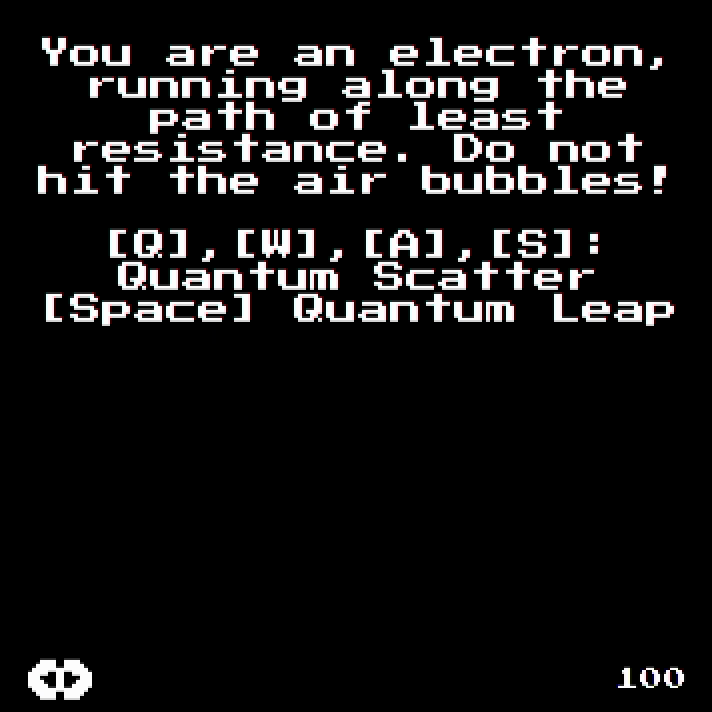
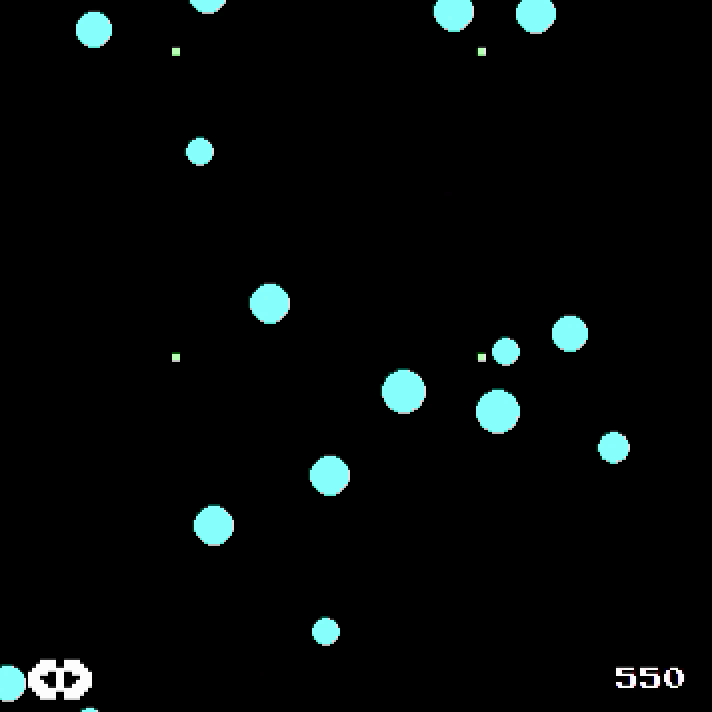
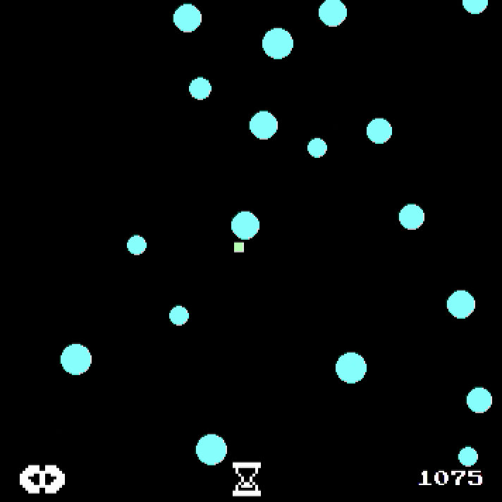

# Electric Bubble Bath

[](https://github.com/yoreei/ElectricBubbleBath/actions/workflows/build.yml)

A retro arcade game written from scratch in C++ on top of raw Win32 and Direct2D, with no game engine.
Made over a weekend for [Global Game Jam 2025](https://globalgamejam.org/games/2025) (theme: *Bubble*).

[](https://youtu.be/UAGAdAS9JEM)

▶ [Watch the full gameplay video on YouTube](https://youtu.be/UAGAdAS9JEM) · ⬇ [Download for Windows](https://github.com/yoreei/ElectricBubbleBath/releases/latest)

## The game

> You are an electron, running along the path of least resistance. Do not hit the air bubbles!

You control four copies of the same electron at once, flying diagonally and bouncing off the walls, while air bubbles drift, wrap around the screen and ricochet off each other.
Every bubble that touches an electron copy destroys it. You score points over time, and the round ends when all four copies are gone.
Beat the high score to win.
The bath gets more crowded and faster as the round goes on.

| Key | Action |
|---|---|
| `Q` `W` `A` `S` | **Quantum Scatter**: collapse all copies onto that electron and scatter them again (costs 75 points) |
| `Space` | **Quantum Leap**: vanish for 2 seconds and pass through bubbles (12 s cooldown) |
| `Esc` | Pause / resume |
| `R` | Restart (from pause or the end screen) |
| `Enter` / `Backspace` | Start / quit (main menu) |

<p>
  
  
  
</p>

## How it's built

- **Rendering:** Direct2D draws into a 360×360 off-screen target with antialiasing off, then scales it up to the screen for crisp pixel art. Sprites are loaded with WIC.
- **Text:** DirectWrite, using the bundled *Press Start 2P* font loaded from the game folder (no install needed).
- **Audio:** [irrKlang](https://www.ambiera.com/irrklang/), streaming Ogg Vorbis music.
- **Gameplay:** a fixed-rate simulation with simple circle physics. Bubbles ricochet off each other weighted by size, and a timed event queue ramps up the difficulty.
- **Code:** a single-window Win32 app split into simulation (`GJSimulation.h`), scene data (`GJScene.h`) and rendering (`GJRenderer.h`).

## Building

Requires Windows 10 or later and Visual Studio 2022 with the *Desktop development with C++* workload.
All dependencies are included in the repository.

1. Open `ElectricBubbleBath.sln`.
2. Select the `Release | x64` configuration.
3. Press F5. The game, `irrKlang.dll` and `assets/` are placed in `x64/Release/`.

Or from a Developer Command Prompt:

```
msbuild ElectricBubbleBath.sln -p:Configuration=Release -p:Platform=x64
```

## Credits

- Game design and code: [yoreei](https://github.com/yoreei)
- Font: [Press Start 2P](https://fonts.google.com/specimen/Press+Start+2P) by CodeMan38, [SIL Open Font License](assets/PressStart2P-OFL.txt)
- Audio library: [irrKlang](https://www.ambiera.com/irrklang/) by Ambiera (free for non-commercial use)
- `vec3` math: adapted from Peter Shirley's [*Ray Tracing in One Weekend*](https://raytracing.github.io) (CC0)
