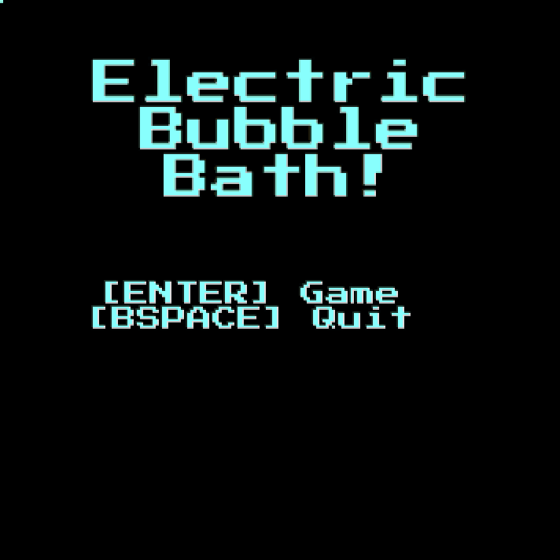

# Electric Bubble Bath

[](https://github.com/yoreei/ElectricBubbleBath/actions/workflows/build.yml)

A small arcade game I made over a weekend for [Global Game Jam 2025](https://globalgamejam.org/games/2025). The theme was "Bubble".
It's written in C++ against Win32 and Direct2D directly, without a game engine.

[](https://youtu.be/UAGAdAS9JEM)

[Gameplay video on YouTube](https://youtu.be/UAGAdAS9JEM) | [Download for Windows](https://github.com/yoreei/ElectricBubbleBath/releases/latest)

## How to play

You are an electron, running along the path of least resistance. Avoid the air bubbles.

The electron exists as four copies at once. They fly diagonally and bounce off the walls. Bubbles drift across the screen, wrap around the edges and bounce off each other, and any copy that touches a bubble is lost. You earn points as long as at least one copy survives. When all four are gone the round ends, and you win if you beat the high score. More bubbles appear and everything speeds up the longer you last.

| Key | Action |
|---|---|
| Q, W, A, S | Quantum Scatter: gather all copies at that electron and send them out again. Costs 75 points. |
| Space | Quantum Leap: disappear for 2 seconds so bubbles pass through you. 12 second cooldown. |
| Esc | Pause and resume |
| R | Restart, from the pause or end screen |
| Enter, Backspace | Start or quit, from the main menu |

<p>
  
  
  
</p>

## Technical notes

The game draws everything into a 360x360 Direct2D render target with antialiasing turned off and then scales that up to fill the screen, which gives the pixel art look. PNG sprites are loaded through WIC. Text goes through DirectWrite with the Press Start 2P font, which the game loads from its own folder. Music is played with irrKlang.

The simulation runs at a fixed rate. Bubbles are circles that push each other apart in proportion to their size, and a timed list of events adds bubbles and raises the speed during a round. The code is split into the simulation (`GJSimulation.h`), the scene data (`GJScene.h`) and the renderer (`GJRenderer.h`).

## Building

You need Windows 10 or later and Visual Studio 2022 with the "Desktop development with C++" workload. The dependencies are checked into the repository.

Open `ElectricBubbleBath.sln`, pick `Release | x64` and press F5. The exe, `irrKlang.dll` and the `assets` folder end up in `x64/Release/`.

From a Developer Command Prompt:

```
msbuild ElectricBubbleBath.sln -p:Configuration=Release -p:Platform=x64
```

## Credits

- Design and code by [yoreei](https://github.com/yoreei)
- [Press Start 2P](https://fonts.google.com/specimen/Press+Start+2P) font by CodeMan38, under the [SIL Open Font License](assets/PressStart2P-OFL.txt)
- [irrKlang](https://www.ambiera.com/irrklang/) audio library by Ambiera, free for non-commercial use
- The `vec3` class is adapted from Peter Shirley's [Ray Tracing in One Weekend](https://raytracing.github.io) (CC0)
